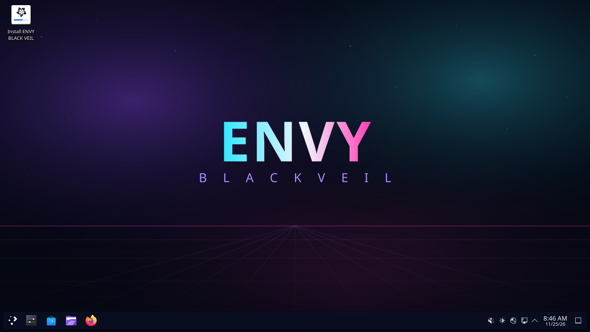

<p align="center">
  
</p>

# ENVY BLACK VEIL

**A Linux world of my own — now a standalone OS.** AlmaLinux 10 + KDE Plasma 6, themed end to end in the ENVY neon palette, encrypted and offline by design. It ships as **just the OS**: every ENVY tool installs onto it afterward, on demand.

<p align="center">
  
</p>

<p align="center">
  
  
  <br />
  
  
  
</p>

> **Built and tested by CI.** Every change builds the ISO in an AlmaLinux 10 VM and boots it in VMs ([ISO workflow](https://github.com/xzchick/envy-black-veil/actions/workflows/iso.yml)): UEFI boot through its own boot menu, the live KDE desktop logging in by itself, SELinux enforcing, the firewall closed, **nothing listening on the network**, and the ENVY look in place. An automated encrypted install and an ARM (Apple Silicon) build are being brought up in CI now; real-hardware testing comes after. It's a young `v0.1.0`.

<p align="center">
  
  <br /><sub>The live desktop, exactly as CI boots it in a VM (QEMU/KVM, UEFI). The Welcome Center names AlmaLinux because BLACK VEIL keeps AlmaLinux's release identity underneath — see the roadmap.</sub>
</p>

## Try it

On **Windows, macOS or Linux** — in a virtual machine (nothing on your computer changes) or from a USB stick:

```sh
./try-black-veil.sh envy-black-veil-0.1.0-x86_64.iso     # macOS (Intel) or Linux, with QEMU
./try-black-veil.sh envy-black-veil-0.1.0-aarch64.iso    # Apple Silicon Mac, once the ARM build is up
```

Step by step for **UTM, Parallels, VMware, Hyper-V, VirtualBox, GNOME Boxes and virt-manager**, plus USB sticks: **[docs/try-it.md](docs/try-it.md)**. The ISO comes from the latest green [ISO workflow run](https://github.com/xzchick/envy-black-veil/actions/workflows/iso.yml) (its *envy-black-veil-iso* artifact, with a SHA-256 file); a signed release download is on the roadmap.

---

## Just the OS

Most "distros with apps" bundle everything and hope you want it. BLACK VEIL does the opposite: the image is a clean, themed KDE desktop plus the **runtime every ENVY tool needs** (Python 3, Qt6, `cryptography`). The tools themselves are **not** baked in — you add exactly the ones you want, after install:

```sh
envy-tools list                        # everything available, and what's installed
envy-tools install vault veil hypothesis
envy-tools install all                 # the whole suite
```

Each one installs into a single isolated environment, lands on your PATH and in the KDE menu, and runs **fully offline** afterward. See [`tools/envy-tools`](tools/envy-tools).

### The tools you can add

| Tool | What it does |
| :--- | :--- |
| **Vault** | AES-256 file encryption |
| **Veil** | hide an encrypted file inside an image or audio carrier |
| **Casebook** | encrypted, revision-preserving case notes |
| **Cryptography Workbench** | encoding, classical ciphers and text analysis |
| **Ops Desk** | encrypted operations plans with authenticated handoffs |
| **Evidence Vault** | copied-file intake with a hash-verified custody journal |
| **Integrity Monitor** | encrypted file-integrity baselines and change detection |
| **Orbit** | encrypted recurring-cadence tracking |
| **SkyWatch** | encrypted watchlists and offline content scanning |
| **Oracle** | encrypted forecasts and calibration scoring |
| **Hypothesis** | Analysis of Competing Hypotheses |
| **Recon** | OSINT terminal for domains, IPs, certificates and file metadata (uses the network, and shows every request) |
| **Tunnel** | self-hosted WireGuard VPN on your own server |

Every one is its own standalone app, installable on BLACK VEIL from its Linux release bundle or with `pip` — and on macOS and Windows too.
On any OS, [ENVY Tools](https://github.com/xzchick/envy-tools) installs and updates them from their signed release bundles, with a window or the same `list`/`install`/`update`/`remove` commands.

---

## Themed end to end

The ENVY look is applied through the whole boot and desktop, not just a wallpaper:

- **GRUB** boot menu — neon backdrop, pink countdown bar.
- **Plymouth** boot splash — the wordmark, a travelling spark, and a LUKS passphrase prompt for encrypted disks.
- **SDDM** login — a dark glass panel with pink/cyan accents.
- **KDE Plasma** — the *ENVY Neon* colour scheme, dark defaults, the wallpaper above.
- **Konsole** — a matching neon terminal profile.

Everything lives in [`theme/`](theme) as one set of palette tokens; change a colour in one file and the look follows. See [docs/customizing.md](docs/customizing.md).

```
BG #050713   PANEL #0a0e22   INK #f2f4ff   PINK #ff3db4
CYAN #35e8ff   LAVENDER #ac8cff   VIOLET #8547e8   GREEN #49e3a6
```

---

## Encrypted & offline by design

- **SELinux enforcing**, the **firewall on with nothing open**, and **nothing listening on the network** — checked by CI on every build. SSH, printing (CUPS), network discovery (Avahi), the Cockpit web console and KDE Connect are off or left out; turn on only what you need.
- **Full-disk LUKS encryption** offered in the installer — the ENVY boot splash prompts for the passphrase.
- No telemetry, no accounts, no phone-home. Every ENVY app except Recon and Tunnel works with **no network** at all.

---

## Boot it from an external SSD, HDD or USB

BLACK VEIL is meant to be portable — installed onto an external drive you carry and boot on almost any PC, leaving the host's internal disk untouched. The full walkthrough, including putting the bootloader on the **external** drive so it's self-contained, is in:

### → [docs/install-to-external-drive.md](docs/install-to-external-drive.md)

Short version: write the ISO to a USB stick, boot it, run **Install ENVY BLACK VEIL** (AlmaLinux's Anaconda installer), select only your **external drive** so the boot loader goes there too, optionally encrypt it, install, and add your tools with `envy-tools`.

---

## Build it

The OS is built the way AlmaLinux builds its own live media, on an AlmaLinux 10 machine or VM (x86_64 or aarch64):

```sh
sudo dnf install -y epel-release
sudo dnf install -y lorax lorax-templates-almalinux anaconda rpm-build createrepo_c pykickstart \
    librsvg2-tools grub2-tools-extra dejavu-sans-fonts
git clone https://github.com/xzchick/envy-black-veil.git
cd envy-black-veil
sudo ./build/build-iso.sh          # -> output/envy-black-veil-0.1.0-<arch>.iso
```

`build/build-iso.sh` builds the ENVY identity RPMs (theme and release file), publishes them to a local repo, and runs `livemedia-creator --no-virt` against [`kickstart/envy-black-veil.ks`](kickstart/envy-black-veil.ks). CI does exactly this in a throwaway AlmaLinux 10 VM, then boots the ISO and checks it. Lint everything anywhere with `make validate`. Full details in [docs/building.md](docs/building.md).

---

## What's inside

| Area | Where |
| :--- | :--- |
| Live-ISO definition | [`kickstart/envy-black-veil.ks`](kickstart/envy-black-veil.ks) |
| ENVY theme (Plasma, SDDM, Plymouth, GRUB, Konsole, wallpaper) | [`theme/`](theme) |
| Identity RPMs (theme, release file, Anaconda GRUB hook) | [`packaging/envy-black-veil.spec`](packaging/envy-black-veil.spec) |
| `envy-tools` on-demand app installer | [`tools/envy-tools`](tools/envy-tools) |
| ISO build script + Makefile | [`build/build-iso.sh`](build/build-iso.sh) |
| CI: build in a VM, boot and check the ISO | [`ci/`](ci) · [ISO workflow](.github/workflows/iso.yml) |
| Try it in a VM with one command (macOS, Linux) | [`try-black-veil.sh`](try-black-veil.sh) |
| Docs (try it, external drive, building, customizing) | [`docs/`](docs) |

---

## Roadmap

- [x] The ISO builds for real in CI, and boots via UEFI to the live KDE desktop with the ENVY look, SELinux enforcing, the firewall closed and nothing listening.
- [ ] Automated encrypted install and installed-system boot test in CI (in progress).
- [ ] aarch64 ISO for Apple Silicon Macs and ARM PCs (in progress).
- [ ] Acceptance on real hardware.
- [ ] Signed packages and a hosted update repo — and with it BLACK VEIL's own release identity (os-release), which needs that repo to stay in step with AlmaLinux's updates.
- [ ] A published, verified ISO release with checksums.
- [ ] Secure Boot: BLACK VEIL uses AlmaLinux's signed boot chain unchanged; verify it boots with Secure Boot on.
- [ ] Optional persistence tuning for USB-stick live use.

<p align="center"><sub>MIT licensed. Created by <a href="https://github.com/xzchick">Envy (@xzchick)</a>. Built on AlmaLinux and KDE; the ENVY identity, theme and tooling are my own.</sub></p>
