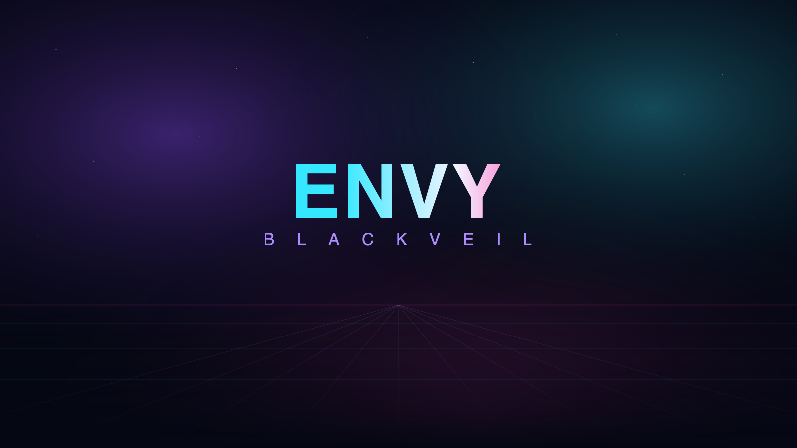
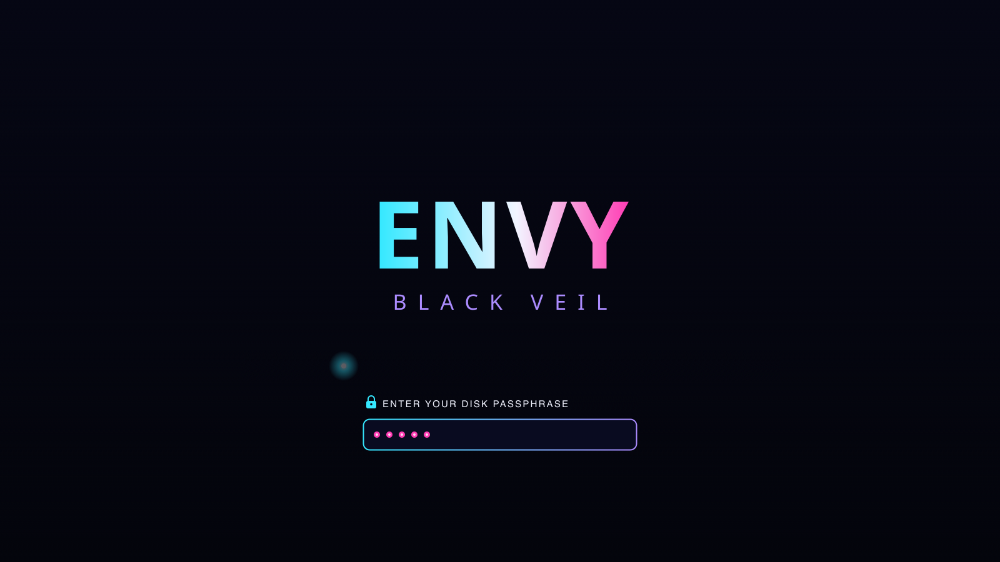
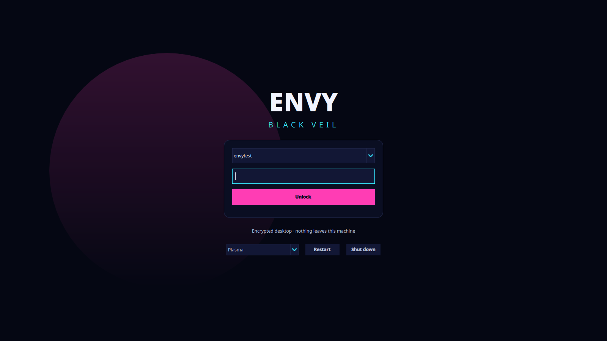
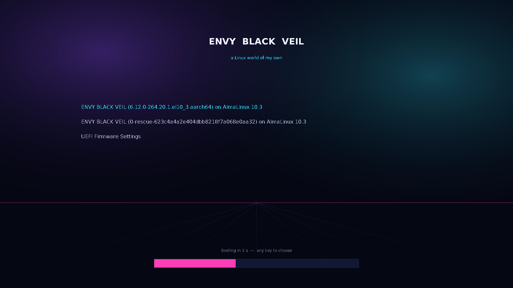
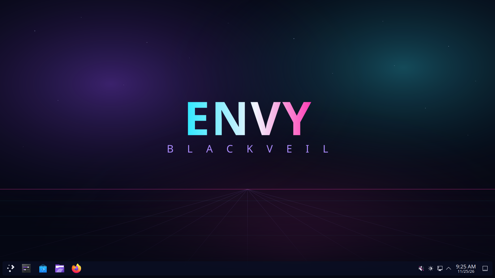

<p align="center">
  
</p>

# ENVY BLACK VEIL

**A Linux world of my own — now a standalone OS.** AlmaLinux 10 + KDE Plasma 6, themed end to end in the ENVY neon palette, encrypted and offline by design. It ships as **just the OS**: every ENVY tool installs onto it afterward, on demand.

<p align="center">
  
</p>

<p align="center">
  
  
  <br />
  
  
  
  <a href="https://github.com/xzchick/envy-black-veil/releases/latest"></a>
</p>

> **Built and tested end to end, for PCs and Apple Silicon.** Every change builds the ISO for **x86_64** and **aarch64** and boots it in VMs ([ISO workflow](https://github.com/xzchick/envy-black-veil/actions/workflows/iso.yml)): UEFI through its own boot menu, **also with Secure Boot on**; the live KDE desktop logging in by itself; SELinux enforcing, the firewall closed, **nothing listening and nothing phoning home**. Then it **installs BLACK VEIL unattended** onto a blank disk with LUKS2 encryption, boots the installed disk on fresh firmware, types the passphrase into the ENVY splash, checks the installed system the same way and signs in on the ENVY login screen. Real-hardware testing comes next. It's a young `v0.1.0`.

<p align="center">
  
  <br /><sub>The live desktop as the automated test boots it (aarch64 on an Apple Silicon Mac).</sub>
</p>

<p align="center">
  
  
  <br /><sub>An installed system: the ENVY splash asks for the disk passphrase, then the ENVY login screen. Screenshots from the automated install test.</sub>
</p>

<p align="center">
  
  
  <br /><sub>The installed system's ENVY boot menu, and its desktop after signing in.</sub>
</p>

## Try it

**[Download v0.1.0](https://github.com/xzchick/envy-black-veil/releases/latest)**: `envy-black-veil-0.1.0-x86_64.iso` for Windows and Linux PCs and Intel Macs, `envy-black-veil-0.1.0-aarch64.iso` for Apple Silicon Macs and ARM PCs. Each comes with Sigstore-signed checksums (how to check them is in the release notes), a package list and an SBOM.

On **Windows, macOS or Linux** — in a virtual machine (nothing on your computer changes) or from a USB stick:

```sh
./try-black-veil.sh envy-black-veil-0.1.0-aarch64.iso    # Apple Silicon Mac (brew install qemu)
./try-black-veil.sh envy-black-veil-0.1.0-x86_64.iso     # Linux or Intel Mac, with QEMU
```

```powershell
# Windows 10/11 Pro with Hyper-V, from an administrator PowerShell
powershell -ExecutionPolicy Bypass -File .\try-black-veil.ps1 .\envy-black-veil-0.1.0-x86_64.iso
```

Each sets up a VM the way BLACK VEIL needs it (UEFI, 6 GB, 4 CPUs, a 40 GB disk to install onto; on Hyper-V, Secure Boot with the Microsoft UEFI CA template) and boots the live desktop. Step by step for **UTM, Parallels, VMware, VirtualBox, GNOME Boxes and virt-manager**, plus USB sticks: **[docs/try-it.md](docs/try-it.md)**. Builds of every later change are kept for 14 days as artifacts of the [ISO workflow](https://github.com/xzchick/envy-black-veil/actions/workflows/iso.yml).

---

## Just the OS

Most "distros with apps" bundle everything and hope you want it. BLACK VEIL does the opposite: the image is a clean, themed KDE desktop plus the **runtime every ENVY tool needs** (Python 3, Qt6, `cryptography`). The tools themselves are **not** baked in — you add exactly the ones you want, after install:

```sh
envy-tools list                        # everything available, and what's installed
envy-tools install vault veil hypothesis
envy-tools install all                 # the whole suite
```

Each one installs into a single isolated environment, lands on your PATH and in the KDE menu, and runs **fully offline** afterward. See [`tools/envy-tools`](tools/envy-tools).

### The tools you can add

| Tool | What it does |
| :--- | :--- |
| **Vault** | AES-256 file encryption |
| **Veil** | hide an encrypted file inside an image or audio carrier |
| **Casebook** | encrypted, revision-preserving case notes |
| **Cryptography Workbench** | encoding, classical ciphers and text analysis |
| **Ops Desk** | encrypted operations plans with authenticated handoffs |
| **Evidence Vault** | copied-file intake with a hash-verified custody journal |
| **Integrity Monitor** | encrypted file-integrity baselines and change detection |
| **Orbit** | encrypted recurring-cadence tracking |
| **SkyWatch** | encrypted watchlists and offline content scanning |
| **Oracle** | encrypted forecasts and calibration scoring |
| **Hypothesis** | Analysis of Competing Hypotheses |
| **Recon** | OSINT terminal for domains, IPs, certificates and file metadata (uses the network, and shows every request) |
| **Tunnel** | self-hosted WireGuard VPN on your own server |

Every one is its own standalone app, installable on BLACK VEIL from its Linux release bundle or with `pip` — and on macOS and Windows too.
On any OS, [ENVY Tools](https://github.com/xzchick/envy-tools) installs and updates them from their signed release bundles, with a window or the same `list`/`install`/`update`/`remove` commands.

---

## Themed end to end

The ENVY look is applied through the whole boot and desktop, not just a wallpaper:

- **GRUB** boot menu — neon backdrop, pink countdown bar.
- **Plymouth** boot splash — the wordmark, a travelling spark, and a LUKS passphrase prompt for encrypted disks.
- **SDDM** login — a dark glass panel with pink/cyan accents.
- **KDE Plasma** — the *ENVY Neon* colour scheme, dark defaults, the wallpaper above.
- **Konsole** — a matching neon terminal profile.

Everything lives in [`theme/`](theme) as one set of palette tokens; change a colour in one file and the look follows. See [docs/customizing.md](docs/customizing.md).

```
BG #050713   PANEL #0a0e22   INK #f2f4ff   PINK #ff3db4
CYAN #35e8ff   LAVENDER #ac8cff   VIOLET #8547e8   GREEN #49e3a6
```

---

## Encrypted & offline by design

- **SELinux enforcing**, the **firewall on with nothing open**, and **nothing listening on the network**, on the live system and on what you install. SSH, printing (CUPS) and network discovery (Avahi) are off; the Cockpit web console, Samba file sharing, KDE Connect and KDE's remote-desktop servers (VNC, RDP) aren't installed. Turn on only what you need.
- **Nothing phones home.** No connectivity check (NetworkManager would fetch a vendor's test page every few minutes), no firmware or DNF "countme" pings on a timer, no location lookup in the installer, and Firefox ships with telemetry, studies and sponsored content off. Updates are still there when you ask: `sudo dnf upgrade`, `fwupdmgr refresh`. See [`privacy/`](privacy).
- **Full-disk LUKS2 encryption** in the installer; the ENVY boot splash asks for the passphrase.
- No accounts. Every ENVY app except Recon and Tunnel works with **no network** at all.
- CI checks every one of these on every build, live and installed.

---

## Boot it from an external SSD, HDD or USB

BLACK VEIL is meant to be portable — installed onto an external drive you carry and boot on almost any PC, leaving the host's internal disk untouched. The full walkthrough, including putting the bootloader on the **external** drive so it's self-contained, is in:

### → [docs/install-to-external-drive.md](docs/install-to-external-drive.md)

Short version: write the ISO to a USB stick, boot it, run **Install ENVY BLACK VEIL** (AlmaLinux's Anaconda installer), select only your **external drive** so the boot loader goes there too, optionally encrypt it, install, and add your tools with `envy-tools`.

---

## Build it

One command from **macOS or Linux** builds it in a throwaway AlmaLinux 10 VM, exactly as CI does (an Apple Silicon Mac builds the aarch64 ISO in about 10 minutes):

```sh
git clone https://github.com/xzchick/envy-black-veil.git && cd envy-black-veil
./ci/build-in-vm.sh                 # macOS: brew install qemu   -> output/envy-black-veil-0.1.0-<arch>.iso
python3 ci/boot-test.py --install --iso output/envy-black-veil-0.1.0-*.iso --out test/   # every CI check, locally
```

Or directly on an AlmaLinux 10 machine or VM (x86_64 or aarch64), the way AlmaLinux builds its own live media:

```sh
sudo dnf install -y epel-release
sudo dnf install -y lorax lorax-templates-almalinux anaconda rpm-build createrepo_c pykickstart \
    librsvg2-tools grub2-tools-extra dejavu-sans-fonts dejavu-sans-mono-fonts
git clone https://github.com/xzchick/envy-black-veil.git
cd envy-black-veil
sudo ./build/build-iso.sh          # -> output/envy-black-veil-0.1.0-<arch>.iso
```

`build/build-iso.sh` builds the ENVY identity RPMs (theme and release file), publishes them to a local repo, and runs `livemedia-creator --no-virt` against [`kickstart/envy-black-veil.ks`](kickstart/envy-black-veil.ks). CI does exactly this in a throwaway AlmaLinux 10 VM, then boots the ISO and checks it. Lint everything anywhere with `make validate`. Full details in [docs/building.md](docs/building.md).

---

## What's inside

| Area | Where |
| :--- | :--- |
| Live-ISO definition | [`kickstart/envy-black-veil.ks`](kickstart/envy-black-veil.ks) |
| ENVY theme (Plasma, SDDM, Plymouth, GRUB, Konsole, wallpaper) | [`theme/`](theme) |
| Identity RPMs (theme, boot menu and entry names, release file, privacy defaults) | [`packaging/envy-black-veil.spec`](packaging/envy-black-veil.spec) |
| Privacy defaults (NetworkManager, Firefox, installer) | [`privacy/`](privacy) |
| `envy-tools` on-demand app installer | [`tools/envy-tools`](tools/envy-tools) |
| ISO build script + Makefile | [`build/build-iso.sh`](build/build-iso.sh) |
| CI: build in a VM, boot, install and check the ISO; package list and SBOM | [`ci/`](ci) · [ISO workflow](.github/workflows/iso.yml) |
| Signed releases (ISOs that passed every check, signed checksums, SBOMs) | [Release workflow](.github/workflows/release.yml) |
| Try it in a VM with one command (macOS, Linux · Windows Hyper-V) | [`try-black-veil.sh`](try-black-veil.sh) · [`try-black-veil.ps1`](try-black-veil.ps1) |
| Docs (try it, external drive, building, customizing) | [`docs/`](docs) |

---

## Roadmap

- [x] The ISO builds for real in CI, and boots via UEFI to the live KDE desktop with the ENVY look, SELinux enforcing, the firewall closed and nothing listening.
- [x] Automated encrypted install and installed-system test: unattended LUKS2 install, the ENVY splash and login screen, and the same privacy checks on the installed system.
- [x] aarch64 ISO for Apple Silicon Macs and ARM PCs.
- [x] Secure Boot: AlmaLinux's signed boot chain, unchanged, boots the live ISO and installed systems with Secure Boot on (Microsoft's keys), with the kernel locked down.
- [x] Nothing phones home by default, and each ISO under GitHub's 2 GiB file limit, with a package list and SBOM.
- [x] A published, verified ISO release: [v0.1.0](https://github.com/xzchick/envy-black-veil/releases/tag/v0.1.0), with Sigstore-signed checksums, package lists and SBOMs. The [release workflow](.github/workflows/release.yml) publishes only ISOs that pass every check.
- [ ] Acceptance on real hardware.
- [ ] Signed packages and a hosted update repo, and with it BLACK VEIL's own release identity (os-release), which needs that repo to stay in step with AlmaLinux's updates.
- [ ] Optional persistence tuning for USB-stick live use.

<p align="center"><sub>MIT licensed. Created by <a href="https://github.com/xzchick">Envy (@xzchick)</a>. Built on AlmaLinux and KDE; the ENVY identity, theme and tooling are my own.</sub></p>
