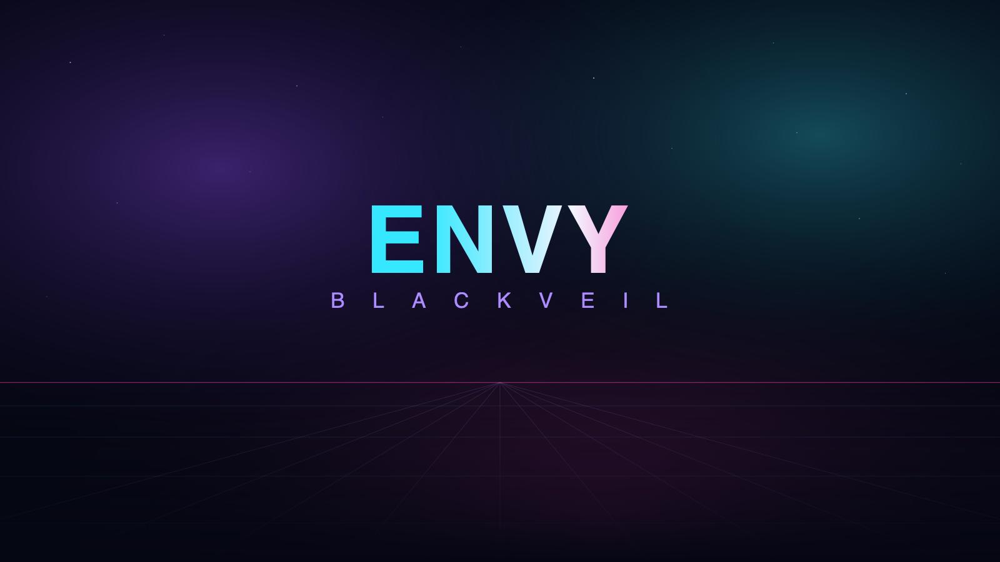

<p align="center">
  
</p>

# ENVY BLACK VEIL

**A Linux world of my own — now a standalone OS.** AlmaLinux 10 + KDE Plasma 6, themed end to end in the ENVY neon palette, encrypted and offline by design. It ships as **just the OS**: every ENVY tool installs onto it afterward, on demand.

<p align="center">
  
</p>

<p align="center">
  
  
  <br />
  
  
  
</p>

> **Early but real.** This repository is the **complete, buildable build system** for the OS — the Kickstart, the ENVY theme, the installer branding and the tooling — not a mock-up. It is a young `v0.1.0`: the ISO is built on a Linux host (see [docs/building.md](docs/building.md)), and full installed-system acceptance on varied hardware is still ongoing.

---

## Just the OS

Most "distros with apps" bundle everything and hope you want it. BLACK VEIL does the opposite: the image is a clean, themed KDE desktop plus the **runtime every ENVY tool needs** (Python 3, Qt6, `cryptography`). The tools themselves are **not** baked in — you add exactly the ones you want, after install:

```sh
envy-tools list                        # everything available, and what's installed
envy-tools install vault veil hypothesis
envy-tools install all                 # the whole suite
```

Each one installs into a single isolated environment, lands on your PATH and in the KDE menu, and runs **fully offline** afterward. See [`tools/envy-tools`](tools/envy-tools).

### The tools you can add

| Tool | What it does |
| :--- | :--- |
| **Vault** | AES-256 file encryption |
| **Veil** | hide an encrypted file inside an image or audio carrier |
| **Casebook** | encrypted, revision-preserving case notes |
| **Cryptography Workbench** | encoding, classical ciphers and text analysis |
| **Ops Desk** | encrypted operations plans with authenticated handoffs |
| **Evidence Vault** | copied-file intake with a hash-verified custody journal |
| **Integrity Monitor** | encrypted file-integrity baselines and change detection |
| **Orbit** | encrypted recurring-cadence tracking |
| **SkyWatch** | encrypted watchlists and offline content scanning |
| **Oracle** | encrypted forecasts and calibration scoring |
| **Hypothesis** | Analysis of Competing Hypotheses |

Every one is its own standalone app, installable on BLACK VEIL from its Linux release bundle or with `pip` — and on macOS and Windows too.

---

## Themed end to end

The ENVY look is applied through the whole boot and desktop, not just a wallpaper:

- **GRUB** boot menu — neon backdrop, pink countdown bar.
- **Plymouth** boot splash — the wordmark, a travelling spark, and a LUKS passphrase prompt for encrypted disks.
- **SDDM** login — a dark glass panel with pink/cyan accents.
- **KDE Plasma** — the *ENVY Neon* colour scheme, dark defaults, the wallpaper above.
- **Konsole** — a matching neon terminal profile.

Everything lives in [`theme/`](theme) as one set of palette tokens; change a colour in one file and the look follows. See [docs/customizing.md](docs/customizing.md).

```
BG #050713   PANEL #0a0e22   INK #f2f4ff   PINK #ff3db4
CYAN #35e8ff   LAVENDER #ac8cff   VIOLET #8547e8   GREEN #49e3a6
```

---

## Encrypted & offline by design

- **SELinux enforcing**, the **firewall on**, and **nothing listening** (`sshd`, `cups` off by default). Turn on only what you need.
- **Full-disk LUKS encryption** offered in the installer — the boot splash prompts for the passphrase.
- No telemetry, no accounts, no phone-home. Every ENVY tool works with **no network**.

---

## Boot it from an external SSD, HDD or USB

BLACK VEIL is meant to be portable — installed onto an external drive you carry and boot on almost any PC, leaving the host's internal disk untouched. The full walkthrough, including putting the bootloader on the **external** drive so it's self-contained, is in:

### → [docs/install-to-external-drive.md](docs/install-to-external-drive.md)

Short version: write the ISO to a USB stick, boot it, run the ENVY installer, pick your **external drive** as both the install target **and** the bootloader location, optionally encrypt it, install, and add your tools with `envy-tools`.

---

## Build it

The OS is built on a Linux host (AlmaLinux 10 / RHEL 10 / Fedora):

```sh
sudo dnf install -y lorax rpm-build createrepo_c pykickstart librsvg2-tools epel-release
git clone https://github.com/xzchick/envy-black-veil.git
cd envy-black-veil
sudo ./build/build-iso.sh          # -> output/envy-black-veil-0.1.0-x86_64.iso
```

`build/build-iso.sh` builds the ENVY identity RPMs (theme, release, Calamares branding), publishes them to a local repo, and runs `livemedia-creator` against [`kickstart/envy-black-veil.ks`](kickstart/envy-black-veil.ks). Lint everything anywhere with `make validate`; CI runs it on every push. Full details in [docs/building.md](docs/building.md).

---

## What's inside

| Area | Where |
| :--- | :--- |
| Live-ISO definition | [`kickstart/envy-black-veil.ks`](kickstart/envy-black-veil.ks) |
| ENVY theme (Plasma, SDDM, Plymouth, GRUB, Konsole, wallpaper) | [`theme/`](theme) |
| Identity RPMs (theme / release / Calamares branding) | [`packaging/envy-black-veil.spec`](packaging/envy-black-veil.spec) |
| Installer branding & module sequence | [`installer/calamares/`](installer/calamares) |
| `envy-tools` on-demand app installer | [`tools/envy-tools`](tools/envy-tools) |
| ISO build script + Makefile | [`build/build-iso.sh`](build/build-iso.sh) |
| Docs (external-drive, building, customizing) | [`docs/`](docs) |

---

## Roadmap

- [ ] Full installed-system and KDE Plasma acceptance in a disposable VM and on real hardware.
- [ ] Signed packages and a hosted update repo.
- [ ] A published, verified ISO release with checksums.
- [ ] Secure Boot signing for broad out-of-the-box UEFI boot.
- [ ] Optional persistence tuning for USB-stick live use.

<p align="center"><sub>MIT licensed. Created by <a href="https://github.com/xzchick">Envy (@xzchick)</a>. Built on AlmaLinux and KDE; the ENVY identity, theme and tooling are my own.</sub></p>
